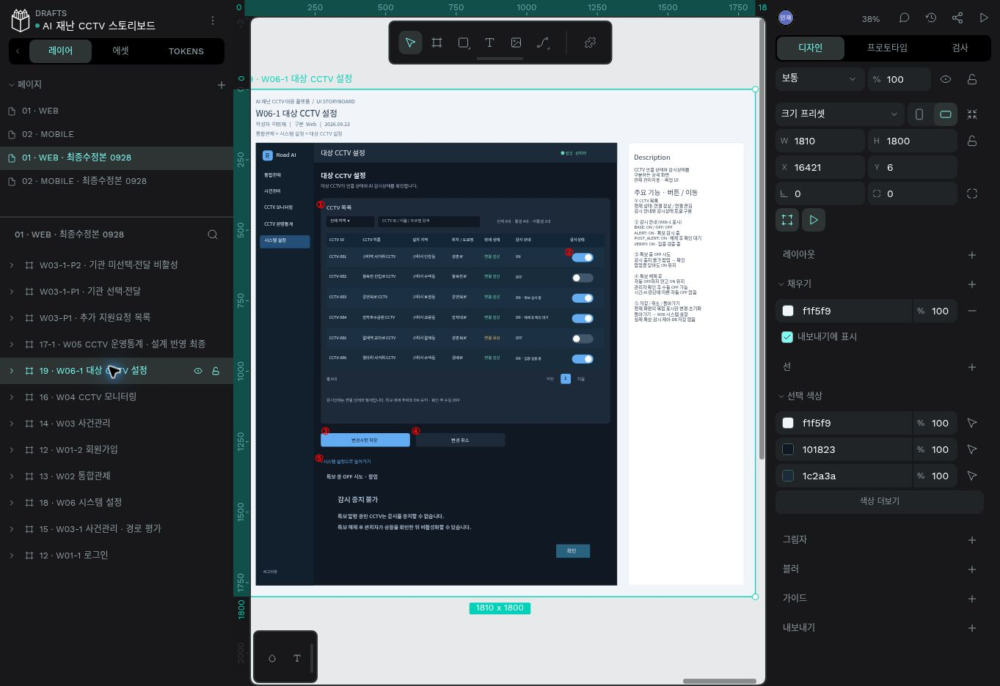
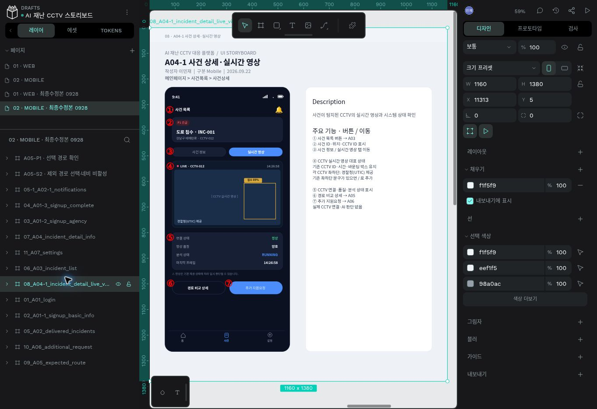

# Penpot 수정 사본 · 2026-09-28

원본 `01 · WEB`, `02 · MOBILE` 페이지를 먼저 복제한 뒤 사본에서만 편집했습니다. 원본 보드·공유 스타일·공통 컴포넌트는 수정하지 않았습니다.

- [01 · WEB · 최종수정본 0928](https://design.penpot.app/#/workspace?team-id=d8ac01df-6646-81d2-8008-ac44f628bb56&file-id=d8ac01df-6646-81d2-8008-ac4abdee3ed7&page-id=51c1e37d-020a-80ac-8008-b4cdadf8b0be&board-id=51c1e37d-020a-80ac-8008-b4d742adaabf) — 12개 보드
- [02 · MOBILE · 최종수정본 0928](https://design.penpot.app/#/workspace?team-id=d8ac01df-6646-81d2-8008-ac44f628bb56&file-id=d8ac01df-6646-81d2-8008-ac4abdee3ed7&page-id=51c1e37d-020a-80ac-8008-b4d39671b27f&board-id=51c1e37d-020a-80ac-8008-b4d53408efe9) — 14개 보드

| 사본 화면 | 반영 내용 |
|---|---|
| W02 통합관제 | 위치 핀·물결 대표 상태, 현재 페이지 5건, 상단 전체 사건 링크, 동기화·호버 Description |
| W03 사건관리 | 최신 지원요청, 요청 목록 연결, 기관 탭·추천경로 1개·단일 경로 비교 버튼, CCTV 버튼 |
| W03-1 경로 평가 | 후보 3개 유지, 기관 선택·전달 진입, 조회와 체크 분리 설명 |
| W04 모니터링 | 높이를 채우는 CCTV 목록·내부 스크롤·좌우 패널 정렬 |
| W05 통계 | 편집 가능한 점·선·날짜·수치로 최근 7일 추이 |
| W03-P1 | 최신순 추가 지원요청 목록·닫기·스크롤 설명 |
| W03-1-P1 / P2 | 복수 선택·전달 상태 / 미선택 비활성 상태 |
| A01-1 / A01-2 | 일반 문장과 로그인 링크 분리·드롭다운 정렬 |
| A05 | 압축 경로 카드·필드 유지·데이터의 제외 상태에 따른 버튼 조건 |
| A05-S2 / A05-P1 | 제외 경로 조회·네비 비활성 / 선택 경로 확인 팝업 |
| A06 / A07 및 관련 화면 | 추가 지원요청 용어·개인정보 처리방침 제거 |

텍스트는 네이티브 텍스트, 차트·핀·버튼은 개별 도형입니다. 통이미지나 윤곽선 SVG 텍스트로 대체하지 않았습니다. 복사본의 클립보드 구조에서 WEB 671개·MOBILE 521개 텍스트 레이어와 49개·67개 프로토타입 연결을 확인했습니다. 이동 목적지는 사본 내부 보드로 연결되며, 기존 뒤로가기 한 곳도 수정본 설정 보드로 명시했습니다.

정적 보드는 대표 상태를 보여줍니다. 영상 재생·물결 애니메이션·반응형·선택 조건은 Description과 실제 React UI로 확인합니다. 모든 프로토타입을 보기 모드에서 끝까지 클릭하는 검사는 별도로 수행하지 않았습니다.

캡처: [사건관리](screenshots/penpot-web.jpg), [모바일 제외 경로](screenshots/penpot-mobile.jpg), [지원요청 목록](screenshots/penpot-support.jpg), [기관 선택·전달](screenshots/penpot-agency.jpg).

## 인수인계 재확인
기존 사본 2개를 실제 열어 사건관리 기관 탭·추천 1개·지원요청·CCTV 버튼과 모바일 제외 경로·회색 네비 버튼·Description을 확인했습니다. 이번에는 페이지·보드·공유 요소를 수정하거나 중복 복제하지 않았습니다. 이번 캡처는 screenshots/recheck-penpot-web.jpg 및 recheck-penpot-mobile.jpg입니다. 위 레이어/연결 개수와 원본 보존 설명은 이전 작업 기록이며, 전체 프로토타입을 다시 끝까지 클릭한 검사는 아닙니다.

## 2차 UI 수정 반영 · 2026-09-28

위 인수인계 재확인 다음에 수행한 작업입니다. 기존 사본을 그대로 사용했고 원본 페이지·공유 요소·페이지 수는 유지했습니다.

- [01 · WEB · 최종수정본 0928](https://design.penpot.app/#/workspace?team-id=d8ac01df-6646-81d2-8008-ac44f628bb56&file-id=d8ac01df-6646-81d2-8008-ac4abdee3ed7&page-id=51c1e37d-020a-80ac-8008-b4cdadf8b0be&board-id=51c1e37d-020a-80ac-8008-b4d742adac10)
- [02 · MOBILE · 최종수정본 0928](https://design.penpot.app/#/workspace?team-id=d8ac01df-6646-81d2-8008-ac44f628bb56&file-id=d8ac01df-6646-81d2-8008-ac4abdee3ed7&page-id=51c1e37d-020a-80ac-8008-b4d39671b27f&board-id=51c1e37d-020a-80ac-8008-b4d53408b7b1)

W06-1 감시 안내 5상태와 특보 OFF 제한 팝업 대표 상태, 시스템 설정의 해제 후 수동 OFF 기준, 두 도로 아이콘·CCTV 출처·역할 명칭·회원가입 중복 조회 안내를 관련 화면과 Description에 반영했습니다. 통합관제 레이아웃·하단 목록과 필터 기준선의 설명도 갱신했습니다. 정확한 보드명과 확인 범위는 [2차 반영표](ROUND2_VERIFICATION.md)를 참고하세요.

새로고침 후 저장된 화면 및 핵심 보드의 텍스트를 다시 확인했습니다. 위의 이전 텍스트/연결 개수는 1차 기록이며 이번 개수로 주장하지 않습니다. 팝업은 W06-1 안의 정적 대표 상태이며 전체 프로토타입 클릭 검사는 미수행입니다.

